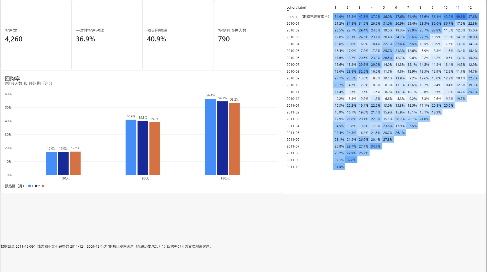
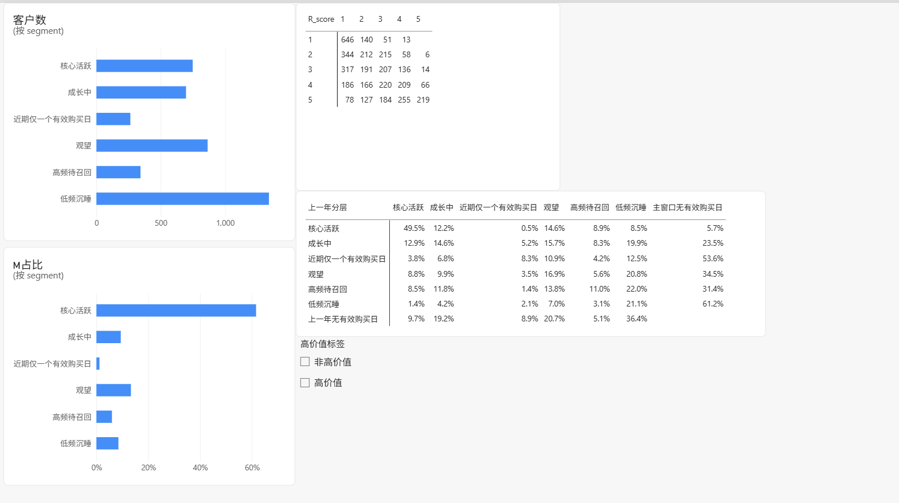
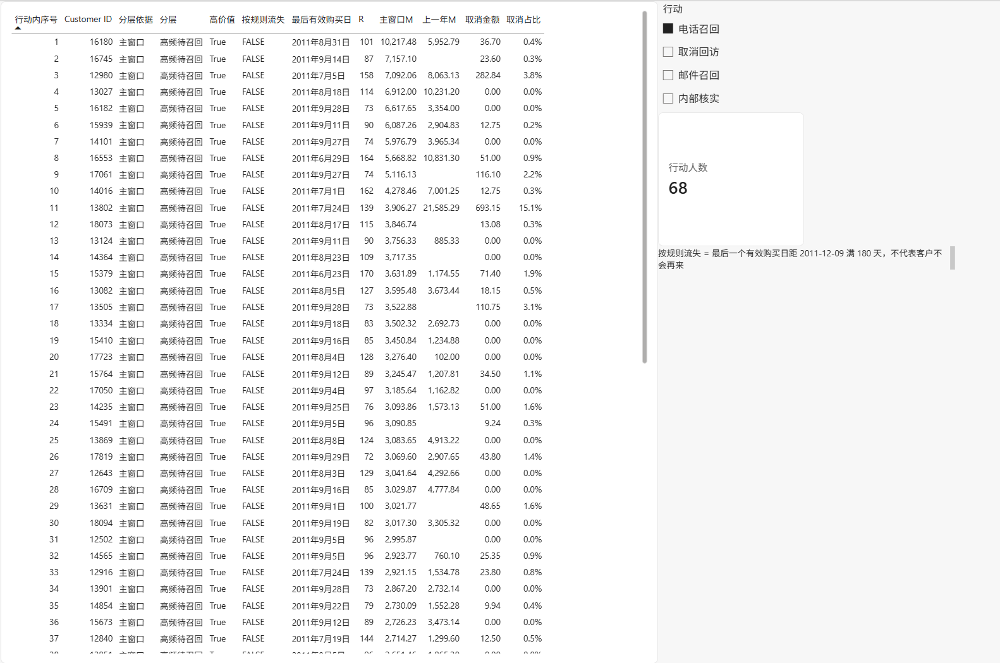

# 零售客户分层与留存分析（Power BI）

用一家英国线上礼品批发商 2009-12 至 2011-12 的交易数据，回答三个运营问题：哪些客户最有价值、首次观察客户之后还回不回来、不同层级的客户该做什么。产出是一个 3 页的 Power BI 报表和一份可执行的行动名单（电话召回、取消回访、邮件召回、内部核实，共 258 人）。

## 1. 业务问题

帮运营通过月度留存、N 天回购率和 RFM 分层，看清两件事：**第一次出现的客户里，有多少人只来过一天就没再回来**，以及**哪些高价值老客正在流失**，从而对不同层级的批发客户采取有针对性的维护和召回动作。

数据只有成交记录，没有登录、访问和未付费用户，所以不做次日 / 7 日留存、DAU/MAU、付费率。

## 2. 关键结论

| 结论 | 数字 | 来源 |
|---|---|---|
| 价值高度集中 | 高价值客户（M 前 20%）852 人，贡献主窗口商品金额的 73.6%；核心活跃 749 人贡献 61.6% | customers.csv |
| 三分之一客户只有一个有效购买日 | 主窗口 4,260 人中 1,571 人（36.9%） | 10_rfm.py |
| 约四成首次观察客户 90 天内回购 | 40.9%（1,759 / 4,303）；30 天 17.0%，180 天 56.4% | 12_cohort.py |
| 月留存约两成 | 首次观察客户加权留存：第 1 月 20.9%，第 6 月 18.5%，第 12 月 18.4% | 12_cohort.py |
| 高频老客流失比例偏高 | 上一年高频待召回 363 人中 114 人（31.4%）主窗口没有再买，是核心活跃（5.7%）的 5 倍多 | migration.csv |
| 召回名单 | 高频待召回且高价值 68 人，其中 8 人已按规则流失 | customers.csv |

## 3. 业务建议

每条建议对应一个动作。召回效果数据里没有，无法验证，以下都是基于现状的建议，不是因果结论。

1. **电话召回 68 人**（高频待召回 × 高价值）：先打未按规则流失的 60 人，组内按 M 从高到低；8 名按规则流失的放最后或改用邮件。
2. **邮件 / 优惠券 167 人**：上一年核心活跃或高频待召回、主窗口没有再买的 157 人，加上主窗口按规则流失的高价值低频沉睡 10 人。其余主窗口未回来的客户留在常规营销。
3. **守住核心活跃**：每月刷新分层，上期核心活跃的客户 R ≥ 40 天就由客户经理主动联系。40 天超过了这群人 3/4 的正常购买间隔（相邻有效购买日间隔中位数 19 天，第 75 百分位 39 天）。这是往后用的监控规则，眼下数据无法验证效果。
4. **取消回访 21 人**：取消金额 ≥ £500 且取消占比 ≥ 20% 的客户电话回访；其余取消由系统在取消时自动收集原因。
5. **结账登记客户**：无客户编号的交易占商品销售额 13.11%，这部分买家无法分层和召回。
6. **大额当天撤单交内部核实**：客户 16446（2011-12-09，80,995 件、£168,469.60，12 分钟后全额取消）和 12346（2011-01-18，74,215 件，16 分钟后全额取消）。数据说不清是录错单还是客户改主意，交给销售或运营查内部单据，不打给客户。这两单在 M 中已互相抵消，同一天整单取消的购买也不计入有效购买日，不影响分层。

各组人数与重叠见 [docs/结果汇总.md](docs/结果汇总.md)。

## 4. 看板

| 页面 | 内容 |
|---|---|
| ① 留存总览 | 指标卡（客户数、一次性客户占比、90 天回购率、按规则流失人数）、cohort 热力图、30/90/180 天回购率 |
| ② RFM 分层 | 各层人数与 M 占比、R×F 矩阵、上一年 → 主窗口分层迁移矩阵（每格占该行的比例），可按高价值筛选 |
| ③ 行动名单 | 按行动切换的客户名单：电话召回 68、取消回访 21、邮件召回 167、内部核实 2，默认显示电话召回，组内按行动内序号排列 |





## 5. 数据

- 来源：Online Retail II，UCI Machine Learning Repository，创建者 Daqing Chen。<https://archive.ics.uci.edu/dataset/502/online+retail+ii>
- 引用：Chen, D. (2012). Online Retail II [Dataset]. UCI Machine Learning Repository. https://doi.org/10.24432/C5CG6D
- 许可：CC BY 4.0。本仓库不包含原始数据，需自行下载。
- 规模：两个工作表合并后 1,067,371 行，2009-12-01 至 2011-12-09。

**数据限制**

- 客户多为批发商，不是普通消费者，结论不能直接套用到零售。
- 只代表 2009–2011 年那个时期。
- 2009-12 之前的历史看不到：2009-12 首次出现的客户称“期初已观察客户”，之后首次出现的称“首次观察客户”，不称“新客”。
- 无客户编号的行占清洗后 22.76%（235,151 行），占商品销售额 13.11%。这些行保留但不进入客户分析，所有客户层面的结论只覆盖有编号的 86.89% 商品销售额。从数量（中位数 1）、单价和单张发票行数看，更像零售散客的小额购买被合并记账，这是推断，数据集没有说明原因。
- 没有取消原因、促销、渠道等字段。

## 6. 口径

完整的口径和每次修订的原因见 [docs/口径与决策.md](docs/口径与决策.md)。主要几条：

- **有效购买日**：非取消发票、商品行、当天至少一行付费商品；同一客户同一天多张发票算 1 天；同一天整单取消的购买不算。
- **RFM 主窗口**：2010-12-10 至 2011-12-09，截止日 2011-12-10。
  - R（Recency，最近一次购买距今多少天）= 截止日 − 最后一个有效购买日；
  - F（Frequency，购买频率）= 窗口内有效购买日数；
  - M（Monetary，消费金额）= 窗口内商品行净金额，取消自动冲减，不含邮费、手工调整、折扣等非商品行。
- **打分与分层**：R、M 按五分位打 1–5 分；F 固定分档（1 / 2 / 3–4 / 5–9 / ≥10 天）。按 R、F 分 6 层：核心活跃、成长中、近期仅一个有效购买日、观望、高频待召回、低频沉睡。M 第 5 档另标“高价值”。
- **按规则流失**：最后一个有效购买日距 2011-12-09 达 180 天及以上。所有相邻有效购买日间隔中 92.7% 不超过 180 天，约 7% 的正常回购会被误标，所以只叫“按规则流失”，不代表客户不会回来。
- **Cohort（同期群）**：按首个有效购买日所在月分组，看之后每月有多少人回来。2009-12 作预热期不进 cohort；2011-12 只有 9 天，不作为首单月或留存月。预热期改成 2 或 3 个月，主要数字最多变动约 3 个百分点。
- **分层迁移**：上一年窗口（2009-12-10 至 2010-12-09）沿用主窗口的五分位切分点，同一分数两年含义一致。

**清洗原则**：只删完全重复行（34,335 行，剩 1,033,036 行），其余问题一律加标记列，不删原始记录。

## 7. 方法与文件

| 文件 | 作用 |
|---|---|
| scripts/01_xlsx_to_csv.py | 合并两个工作表，转成 CSV |
| scripts/02–07 | 数据质量检查（只统计，不改数据） |
| scripts/08_clean.py | 清洗，输出 data/clean_lines.csv |
| scripts/09_purchase_gaps.py | 购买间隔分布，用来定 N 和流失阈值 |
| scripts/10_rfm.py、11_migration.py | 主窗口 RFM 与分层迁移 |
| scripts/12_cohort.py | cohort 留存、N 天回购率、预热期敏感性分析 |
| scripts/13_powerbi_tables.py | 输出 Power BI 用的 4 张表到 data/powerbi/ |
| scripts/14_no_id_profile.py | 无客户编号行画像 |
| scripts/15_cancel_profile.py | 取消金额与取消占比，用来定回访门槛 |
| scripts/16_readme_check.py | 重算 README 里的每个数字，用来核对 |
| scripts/17_action_list.py | 输出第 3 页用的行动名单 data/powerbi/actions.csv |
| 零售客户分层与留存BI.pbip | Power BI 项目文件（PBIP 格式） |
| docs/ | 口径与决策、分析发现、结果汇总、Power BI 搭建步骤 |

## 8. 复现

1. 安装依赖：`pip install -r requirements.txt`
2. 从 UCI 下载数据，把 `online_retail_II.xlsx` 放到 `data/online+retail+ii/`。
3. 在项目根目录依次运行：
   ```
   python scripts/01_xlsx_to_csv.py
   python scripts/08_clean.py
   python scripts/10_rfm.py
   python scripts/11_migration.py
   python scripts/12_cohort.py
   python scripts/13_powerbi_tables.py
   python scripts/17_action_list.py
   ```
   02–07、09、14、15 是检查和画像脚本，按需运行；16 用来核对 README 的数字。
4. 用 Power BI Desktop 打开 `零售客户分层与留存BI.pbip`。5 张表的数据源是本地绝对路径，先在「转换数据 → 数据源设置」里改成你自己的 `data/powerbi/` 路径，再刷新。
